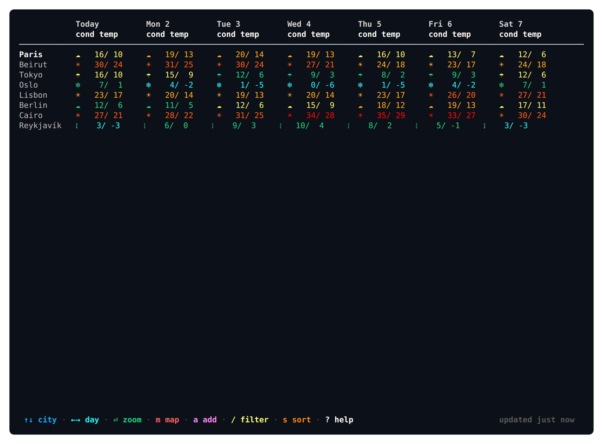
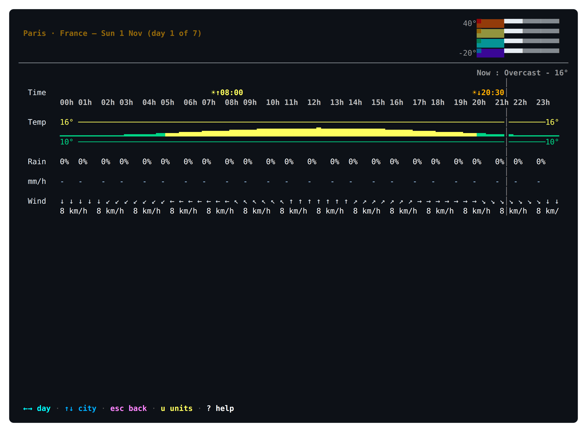
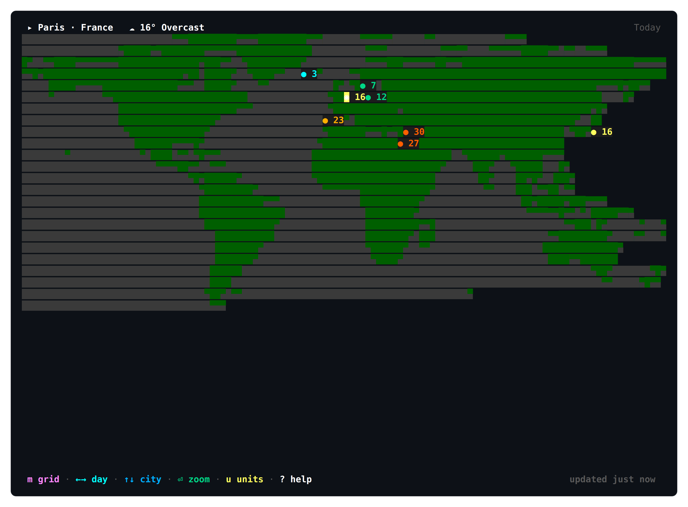

# weatherdash

A terminal weather dashboard: a **cities × days matrix** that answers *"across the
places I care about, where is the weather good this week?"* in a single screen.
Any cell zooms into that city's hourly breakdown for that day.

Built in Go with [Bubble Tea](https://github.com/charmbracelet/bubbletea), powered by
[Open-Meteo](https://open-meteo.com) — no API key required.



Zoom into a day for the hourly picture, or switch to a world map of all your cities:

<p>


</p>

## Features

- **Cities × days grid** — temperature, condition, and rain at a glance; the cursor
  spans both axes and zooming never loses your place
- **Hourly detail** — sparklines, sun arc, sunrise/sunset, and "now" marker for any
  city/day
- **World map view** — saved cities plotted on a generated land mask with live
  temperature chips
- **City management** — fuzzy search backed by Open-Meteo geocoding, duplicate
  detection, delete confirmation
- **View transforms** — filter across name/region/country, sort alphabetically or by
  timezone, manual reorder; all non-destructive
- **Sane defaults** — metric ⇄ imperial toggle, compact/expanded density,
  cache-first startup that paints instantly and refreshes in the background
- **One HTTP request per refresh** — all cities fetched in a single batched call

## Install

Requires Go 1.26 or later:

```bash
go install github.com/tsoueid/360WeatherDashTUI/cmd/weatherdash@latest
```

Or build from a checkout:

```bash
make build    # produces ./weatherdash
```

## Usage

```bash
weatherdash           # your saved cities
weatherdash --demo    # synthetic data, zero network
weatherdash --version
```

| Key | Action |
| --- | --- |
| `↑↓` / `←→` | move city / day cursor |
| `⏎` | zoom into hourly detail (`esc` back) |
| `m` | toggle world map view |
| `a` | add a city |
| `d` | delete the city under the cursor |
| `/` | filter cities |
| `s` | cycle sort mode · `K`/`J` reorder in manual sort |
| `z` | density · `u` units · `r` refresh now |
| `?` | help |

Vim-style `h`/`j`/`k`/`l` movement works throughout.

Config and cache live under your XDG config/cache directories and are written
atomically; nothing is sent anywhere except Open-Meteo.

## Development

```bash
make test    # go test ./... -race
make lint    # go vet + gofmt
make run     # build and run
```

See [AGENTS.md](AGENTS.md) for the full architecture walkthrough.
